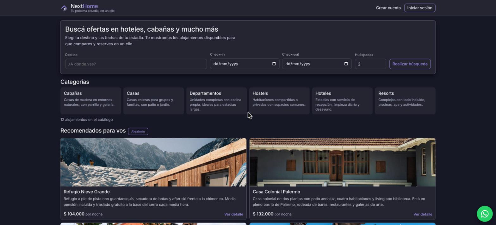
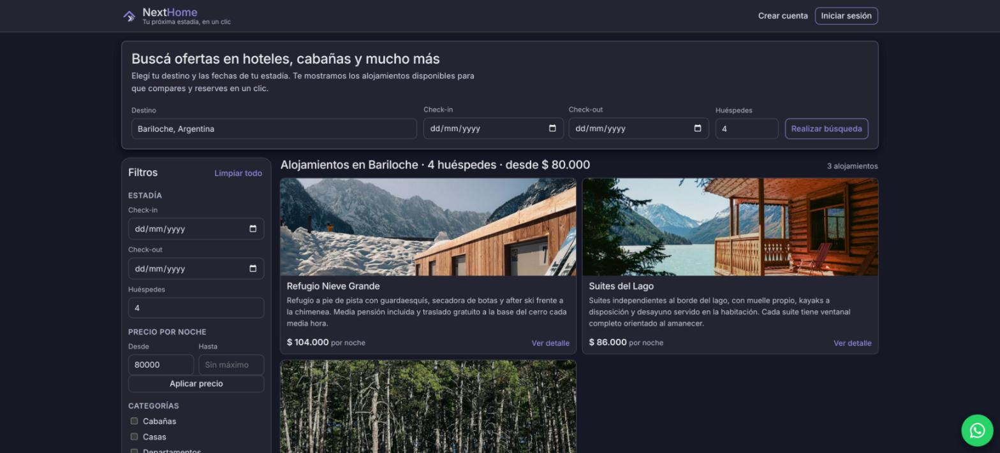
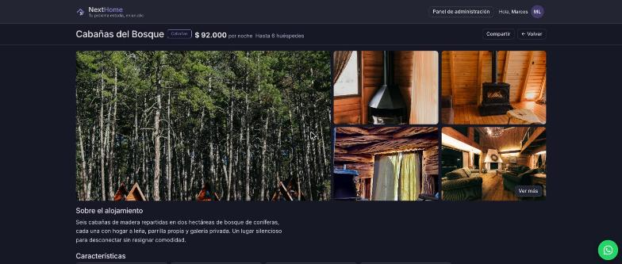
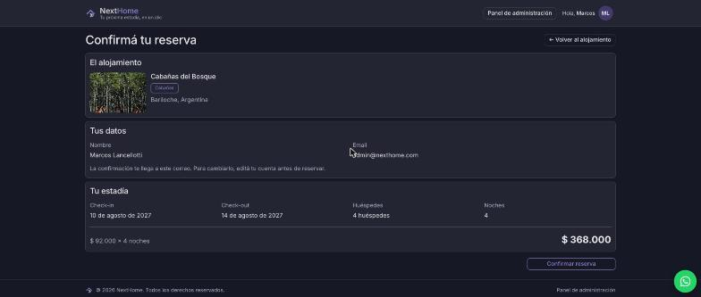
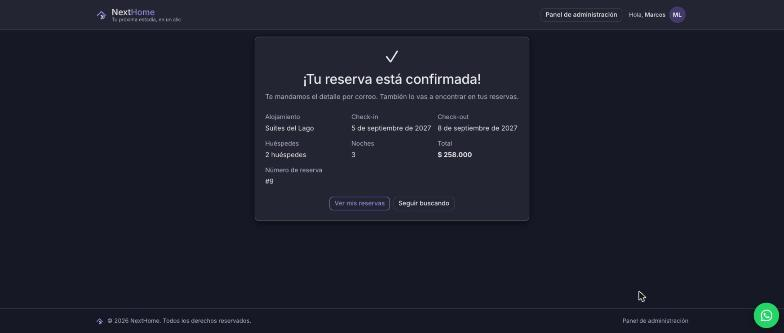
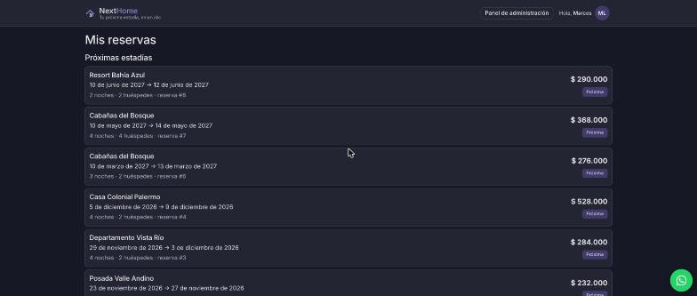
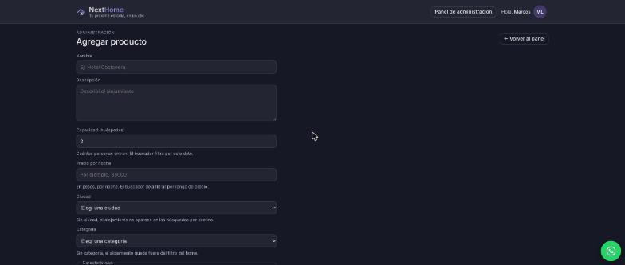
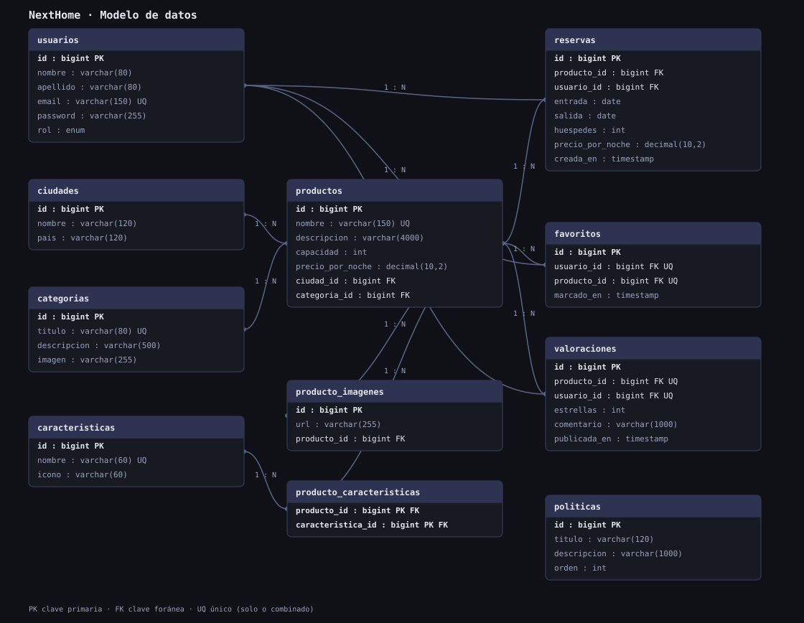

# NextHome · Tu próxima estadía, en un clic

NextHome es un sitio de reservas de alojamientos: hoteles, departamentos, cabañas y hostels.
Lo armé como Desafío Profesional, tomando como referencia sitios del estilo de Booking pero
con identidad propia.

La idea es simple. Entrás al home y te encontrás con una selección de alojamientos que
cambia en cada visita, podés filtrar por categoría, meterte en cualquiera para ver sus
fotos, su descripción y sus características, y si sos administrador tenés un panel aparte
para gestionar el catálogo.

Son dos aplicaciones que conviven en el mismo repositorio: una API en **Java con Spring
Boot** (`backend/`) y un sitio en **React con Vite** (`frontend/`).

## Tecnologías

**Backend**

| Qué | Versión |
| --- | --- |
| Java | 21 |
| Spring Boot | 3.4.1 |
| Spring Web, Data JPA, Security, Validation, Mail | (starters de Boot) |
| jjwt (JSON Web Token) | 0.12.6 |
| H2 (desarrollo) / PostgreSQL (producción) | según perfil |
| Maven | 3.9.16 (incluye wrapper: `./mvnw`) |
| JUnit 5 + MockMvc + AssertJ | (spring-boot-starter-test) |

**Frontend**

| Qué | Versión |
| --- | --- |
| React | 19.2 |
| Vite | 8.2 |
| React Router | 7.18 |
| Axios | 1.19 |
| Vitest | 4.1 |
| Testing Library (React, jest-dom, user-event) | 16.3 / 7.0 / 14.6 |

Sin framework de UI: los estilos son CSS propio, con el sistema de diseño en
`frontend/src/styles/index.css`.

## Qué se puede hacer

**Como visitante**

Al entrar al home te encontrás con el buscador y, debajo, una selección de los mejores
alojamientos, distinta en cada visita.

El buscador es el centro del home: tiene su título, una bajada que explica para qué sirve,
el destino con **autocompletado** (escribís "bari" y te sugiere Bariloche, ignorando tildes
y mayúsculas, y también encontrás por país), el rango de fechas con check-in y check-out, y
los huéspedes. Buscar te lleva a la **página de búsqueda**, con los resultados a la vista.

En el home, el filtro por categorías acota el catálogo y el contador te dice cuántos
cumplen el filtro sobre el total. Si marcás categorías y después buscás, se van con la
búsqueda.

**La página de búsqueda** (`/busqueda`) tiene el buscador arriba, los filtros en una
columna a la izquierda y los resultados a la derecha:

- **Estadía**: check-in, check-out y huéspedes.
- **Precio por noche**: un rango con mínimo y máximo. Se aplica al confirmarlo y no
  mientras escribís, para no disparar una búsqueda por cada tecla.
- **Categorías**: podés marcar varias; alcanza con que el alojamiento esté en una.
- **Características**: acá es al revés, se piden **todas** las que marques. Si elegís
  pileta y cochera, sólo aparecen los que tienen las dos.

Los filtros viven en la **URL**: `/busqueda?ciudad=1&huespedes=4&precioMinimo=90000`. Eso
hace que una búsqueda se pueda compartir por link, que el botón "atrás" del navegador
deshaga el último filtro y que recargar no pierda nada. Si la búsqueda queda vacía, te dice
cuál filtro la dejó así y te ofrece aflojarlo con un clic.

La búsqueda **espera a que termines de elegir**: la URL responde a cada click, pero la
consulta sale recién cuando parás, así que tildar tres filtros seguidos es una sola
búsqueda y no tres. Mientras tanto los resultados anteriores se quedan en pantalla,
atenuados, con un indicador de que algo está en curso: la lista no se borra ni la página
pega un salto en cada click.

Si cargás las dos fechas, la búsqueda deja afuera lo que ya está reservado en ese rango.
Con una sola fecha no alcanza para saber qué está ocupado, así que en ese caso no filtra.
Los huéspedes también acotan el resultado: se descartan los alojamientos donde no entra esa
cantidad de gente.

En el detalle, el bloque **Disponibilidad** tiene arriba los campos de ingreso y egreso, y
debajo un calendario doble, dos meses separados por una división, con las fechas ocupadas
tachadas y en gris. Las dos formas de elegir están sincronizadas: escribís la fecha o la
tocás en el calendario, y da igual. Un clic fija la entrada y el
siguiente la salida. Si el rango elegido pisa noches ya reservadas, esas noches se
marcan aparte dentro de la selección y el botón de reservar queda bloqueado hasta que
elijas otras fechas. La noche del check-out queda libre para el
siguiente huésped, así que dos estadías pueden encadenarse. Si la consulta de fechas falla,
el bloque te avisa y te deja reintentar.

Más abajo está **Opiniones**: el promedio de estrellas, las reseñas publicadas con su
autor y su fecha, y, si ya te hospedaste ahí, el formulario para puntuar del 1 al 5 y
dejar un comentario. Sólo opina quien terminó una estadía, y cada persona deja una sola
opinión: si vuelve a puntuar, actualiza la suya. El promedio también se ve en las tarjetas
del listado.

Abajo del todo, en cada alojamiento, está el bloque **"Qué tenés que saber"**, con las
políticas de uso repartidas en columnas: normas de la casa, salud y seguridad, y
cancelación. Y desde el botón **Compartir** del encabezado abrís una ventana con la foto,
la descripción y el enlace del alojamiento, un mensaje que podés editar y los logos de
Facebook, X y WhatsApp. Debajo está el enlace a la vista con un botón para copiarlo y
mandarlo por donde quieras: Instagram, un mail o un mensaje.

Si entrás a cualquier alojamiento, arriba te espera una galería: una foto grande a la
izquierda y cuatro más en una grilla a la derecha. Con el "Ver más" de la esquina se abren
todas las fotos que tenga cargadas. Abajo de la descripción está el bloque de
**características** —wifi, pileta, cocina, lo que tenga— cada una con su ícono.

El buscador todavía no busca de verdad, es sólo la interfaz. Eso llega en el próximo sprint.

**Como usuario registrado**

Cada alojamiento del listado tiene un **corazón** para marcarlo como favorito de un solo
clic. El corazón sólo aparece con sesión iniciada, porque los favoritos se guardan en tu
cuenta y no en el navegador. Desde el avatar del header entrás a **Mis favoritos**, que
muestra lo que marcaste, del más reciente al más viejo, y te deja quitarlos desde ahí
mismo. Todo se sincroniza en el momento: si sacás un favorito en el home, desaparece de la
lista sin recargar.

Podés crear una cuenta con tu nombre, apellido, email y contraseña. El formulario valida
todo en el momento y te avisa campo por campo qué falta, sin borrarte lo que ya escribiste.
Si el email ya está en uso te lo dice explícitamente.

Una vez adentro, el header cambia: en lugar de los botones de cuenta aparece un avatar con
tus iniciales. Desplegándolo tenés tus datos, **Mis favoritos**, **Mis reservas** y la
opción de cerrar sesión. La sesión sobrevive a las recargas de página, y al cerrarla seguís
navegando el sitio como anónimo sin que nada te bloquee.

**Reservar**

Desde el detalle elegís las fechas en el calendario y el bloque te muestra las noches y el
total antes de seguir. "Reservar" te lleva a una **página de reserva aparte**, no confirma
en el acto: ahí revisás el alojamiento, tus datos, las fechas y el total desglosado
(precio por noche × noches). Confirmar una reserva no debería pasar de un clic sin revisión.

Si todavía no iniciaste sesión, el bloque te lo avisa **antes** de que lo intentes, y el
botón te lleva a ingresar guardando a dónde volver: entrás y caés de nuevo en tu reserva,
con las fechas que habías elegido. La página de login explica por qué se te pidió la sesión.

Al confirmar llegás a una **pantalla de confirmación** con el número de reserva y el
detalle completo, y te mandamos el mismo detalle por correo. Esa pantalla vive en el estado
de la navegación y no en la URL: recargarla no crea otra reserva ni muestra una vieja.

En **Mis reservas** tenés tu historial, separado entre próximas estadías y anteriores, con
las fechas, las noches, los huéspedes y lo que pagaste. El precio queda congelado en la
reserva: si después cambia la tarifa del alojamiento, lo que ya reservaste sigue valiendo
lo mismo.

En cualquier página, abajo a la derecha, hay un **botón de WhatsApp** para consultar. No
hace falta tener sesión: es justamente para quien todavía no se decidió.

**Como administrador**

Entrás por `/administracion` y tenés seis funciones:

- **Lista de productos**: ver el catálogo, editar cualquier alojamiento o eliminarlo.
- **Agregar producto**: nombre, descripción, capacidad, ciudad, categoría, características
  y fotos. La ciudad y la categoría son obligatorias: sin ellas el alojamiento no entra ni
  en la búsqueda por destino ni en el filtro del home. El formulario valida todo antes de
  enviar, marca el campo con problema y te lleva el foco ahí. Si una foto supera los 10 MB,
  te dice cuál y cuánto pesa en el momento de elegirla.
- **Editar producto**: lo mismo, sobre uno ya publicado. Si no elegís fotos nuevas se
  conservan las que tenía; si elegís, reemplazan a las anteriores.
- **Agregar categoría**: título, descripción e imagen representativa. También se editan y
  se eliminan. Antes de borrar, el aviso dice cuántos alojamientos quedarán sin categoría
  y aclara que esos alojamientos no se eliminan.
- **Administrar características**: alta, edición y baja, cada una con su ícono asociado.
- **Usuarios registrados**: el listado completo, con la posibilidad de dar y quitar
  permisos de administrador.

Antes de borrar cualquier cosa siempre te pide confirmación.

Dos aclaraciones importantes:

- **Nadie puede quitarse a sí mismo el permiso de administrador.** Si el último
  administrador pudiera hacerlo, el sistema quedaría sin nadie que pueda volver a
  asignarlo.
- **El panel no anda en celulares**, y es a propósito. Si entrás desde una pantalla chica
  te muestra un cartel explicándote que uses una computadora.

## Para levantarlo

Vas a necesitar **Java 21 o más**, **Maven** y **Node 18 o más**.

Son dos terminales, una para cada aplicación.

En la primera, el backend:

```bash
cd backend
mvn spring-boot:run
```

Queda en `http://localhost:8080`.

Como la base de desarrollo es H2 en memoria, arranca vacía cada vez que la levantás. Para
que no te encuentres con un home pelado, al iniciar se cargan solos el usuario
administrador, 5 ciudades, 6 categorías, 10 características y 12 alojamientos de ejemplo
con sus fotos, repartidos entre los destinos y con categoría y características asignadas. Ojo con esto: **lo que cargues por el
panel se pierde al reiniciar el backend**. Es lo esperable en desarrollo, y más abajo está
cómo pasar a una base de verdad.

Si querés espiar la base por dentro, la consola de H2 está en `http://localhost:8080/h2-console`
(URL `jdbc:h2:mem:nexthome`, usuario `sa`, sin contraseña).

En la segunda terminal, el frontend:

```bash
cd frontend
npm install
npm run dev
```

Y ahí sí, el sitio en `http://localhost:5174`. Lo dejé en el 5174 y no en el 5173 que usa
Vite por defecto, para no pisarme con otros proyectos. Si querés cambiarlo está en
`vite.config.js`.

### Cómo entrar como administrador

Alguien tiene que poder entrar al panel la primera vez, así que al arrancar se crea un
administrador si todavía no existe:

| Email | Contraseña |
| --- | --- |
| `admin@nexthome.com` | `Admin1234` |

Con esa cuenta entrás a `/administracion` y desde ahí podés darle permisos a cualquier otro
usuario registrado. Las credenciales se cambian con las variables de entorno `ADMIN_EMAIL`
y `ADMIN_PASSWORD`; **para producción, cambialas**.

### Cómo registrarse

Desde "Crear cuenta" en el header, o entrando directo a `/crear-cuenta`. Pide nombre,
apellido, email y una contraseña de al menos 8 caracteres. Apenas te registrás quedás
identificado, no hace falta volver a loguearte. Después se entra por `/ingresar`.

Las contraseñas se guardan hasheadas con BCrypt: nunca se guardan en texto plano ni se
devuelven en ninguna respuesta de la API.

## Configuración

El frontend sólo necesita saber dónde está la API. Por defecto asume `http://localhost:8080`,
y si necesitás otra cosa creás un `frontend/.env` con `VITE_API_URL` apuntando a donde sea
(hay un `.env.example` de referencia). También lee `VITE_WHATSAPP_NUMERO`, el número del
botón de contacto, en formato internacional y sin signos.

El backend anda sin configurar nada en desarrollo. Estas son las variables que lee, todas
con un valor por defecto razonable:

| Variable | Para qué | Por defecto |
| --- | --- | --- |
| `JWT_SECRET` | Clave con la que se firman los tokens. Mínimo 32 caracteres. | clave de desarrollo |
| `JWT_EXPIRATION_MINUTES` | Cuánto dura un token antes de vencer. | `120` |
| `ADMIN_EMAIL` | Email del administrador precargado. | `admin@nexthome.com` |
| `ADMIN_PASSWORD` | Su contraseña. | `Admin1234` |
| `DB_URL`, `DB_USER`, `DB_PASSWORD` | PostgreSQL, sólo en el perfil `prod`. | PostgreSQL local |
| `UPLOADS_DIR` | Dónde se guardan las fotos, sólo en `prod`. | `/var/lib/nexthome/uploads` |
| `CORS_ORIGINS` | Orígenes que pueden consumir la API, sólo en `prod`. | `http://localhost:5174` |
| `CORREO_HABILITADO` | Si se envían de verdad los correos de confirmación. En `false` quedan escritos en el log. | `false` |
| `CORREO_DESDE` | Remitente de los correos. | `no-reply@nexthome.com` |
| `SMTP_HOST`, `SMTP_PORT` | Servidor de correo. | `smtp.gmail.com`, `587` |
| `SMTP_USUARIO`, `SMTP_PASSWORD` | Credenciales del servidor de correo. | vacías |

Hay un `backend/.env.example` con todas, listo para copiar como `.env`.

En producción hay dos que sí o sí hay que setear: **`JWT_SECRET`** (si no, cualquiera que
lea este repositorio puede firmarse un token de administrador) y **`ADMIN_PASSWORD`**.

### Pasar de H2 a PostgreSQL

No hay que tocar una línea de Java. Está todo preparado en el perfil `prod`.

Primero, creá la base:

```sql
CREATE DATABASE nexthome;
```

Las tablas las crea solo Hibernate al arrancar (`ddl-auto=update`), así que no hay script
de esquema que correr. La carga inicial —administrador, ciudades, categorías,
características y los 12 alojamientos de ejemplo— también se ejecuta sola la primera vez.

Después levantá el backend con el perfil:

```bash
cd backend
mvn spring-boot:run -Dspring-boot.run.profiles=prod
```

Si tu PostgreSQL no está en `localhost:5432` o usa otro usuario, pasale `DB_URL`,
`DB_USER` y `DB_PASSWORD` como variables de entorno.

Con eso los alojamientos que cargues sobreviven a los reinicios.

## La API

Todo cuelga de `http://localhost:8080/api`. La autenticación es por **JWT**: el token se
manda en el header `Authorization: Bearer <token>`. No hay sesión de servidor, porque el
frontend es una SPA aparte.

En la columna **Auth**: ❌ público, 🔒 requiere sesión, 👑 administrador.

| Método | Endpoint | Descripción | Auth |
| --- | --- | --- | --- |
| POST | `/api/auth/registro` | Crea una cuenta y devuelve el token | ❌ |
| POST | `/api/auth/login` | Inicia sesión | ❌ |
| GET | `/api/auth/perfil` | Datos del usuario del token | 🔒 |
| GET | `/api/productos` | Catálogo paginado, con todos los filtros | ❌ |
| GET | `/api/productos/{id}` | Detalle de un alojamiento | ❌ |
| GET | `/api/productos/random` | Recomendaciones aleatorias del home | ❌ |
| POST | `/api/productos` | Alta de alojamiento (multipart, con fotos) | 👑 |
| PUT | `/api/productos/{id}` | Edición | 👑 |
| DELETE | `/api/productos/{id}` | Baja | 👑 |
| GET | `/api/ciudades` | Destinos para el buscador | ❌ |
| GET | `/api/categorias` | Categorías | ❌ |
| GET | `/api/caracteristicas` | Características | ❌ |
| GET | `/api/politicas` | Políticas de uso del alojamiento | ❌ |
| POST/PUT/DELETE | `/api/categorias`, `/api/caracteristicas` | Su gestión | 👑 |
| GET | `/api/reservas/disponibilidad/{productoId}` | Tramos ocupados | ❌ |
| POST | `/api/reservas` | Crea una reserva | 🔒 |
| GET | `/api/reservas/mias` | Historial del usuario | 🔒 |
| GET | `/api/favoritos` | Favoritos del usuario | 🔒 |
| PUT / DELETE | `/api/favoritos/{productoId}` | Marcar y desmarcar | 🔒 |
| GET | `/api/productos/{id}/valoraciones` | Promedio y reseñas | ❌ |
| POST | `/api/productos/{id}/valoraciones` | Puntuar (sólo si se hospedó) | 🔒 |
| GET | `/api/usuarios` | Listado de usuarios | 👑 |
| PATCH | `/api/usuarios/{id}/rol` | Dar o quitar permisos de administrador | 👑 |

El detalle de cada uno, con sus parámetros y códigos de respuesta:

**Autenticación** (público)

- `POST /auth/registro` crea la cuenta y devuelve el token junto con los datos del usuario.
- `POST /auth/login` mismo formato de respuesta. Si las credenciales no sirven contesta
  `401` con un mensaje genérico, sin aclarar si falló el email o la contraseña.
- `GET /auth/perfil` devuelve el usuario del token. Es el que usa el frontend para
  revalidar la sesión al recargar la página.

**Catálogo** (lectura pública, escritura sólo administradores)

- `GET /productos?page=0&size=10` trae el catálogo paginado, nunca más de 10 por página.
  Con `&ciudad=1` lo acota a un destino y con `&categorias=1&categorias=3` a esas
  categorías; los dos se combinan. La respuesta trae `totalElementos` (lo que entra en los
  filtros) y `totalSinFiltro` (el total de referencia: el destino buscado, o el catálogo
  entero si no se buscó ninguno).
- `GET /ciudades` trae los destinos disponibles para el buscador. Es público.
- `GET /politicas` trae las políticas de uso que se muestran en el detalle. Es público.
- `GET /productos?entrada=2026-11-10&salida=2026-11-13` deja afuera lo reservado en ese
  rango. Se combina con `ciudad`, `categorias` y `huespedes`, que descarta lo que tenga
  menos capacidad que la pedida.
- `GET /productos?precioMinimo=50000&precioMaximo=120000` acota por precio por noche. Si
  vienen dados vuelta se entienden como un rango igual. También `&caracteristicas=2&caracteristicas=9`,
  que pide los alojamientos que tengan **todas** las indicadas, no cualquiera de ellas:
  quien filtra por pileta y cochera quiere las dos cosas.

**Reservas**

- `GET /reservas/disponibilidad/{productoId}` trae los tramos ocupados de un alojamiento,
  de hoy en adelante. Es público: se consulta antes de decidirse.
- `POST /reservas` crea una reserva. Hace falta sesión iniciada. Responde `409` si esas
  fechas ya están tomadas y `400` si el rango no tiene sentido o supera las 30 noches.
  La respuesta trae `precioPorNoche`, `noches` y `total`. El precio se **copia** a la
  reserva al crearla: si después se cambia la tarifa del alojamiento, lo que ya se
  reservó sigue valiendo lo mismo.
  Al confirmarse se manda un correo al usuario. Sin SMTP configurado
  (`CORREO_HABILITADO=false`, que es el valor por defecto) el correo no se envía: queda
  escrito en el log, para que una reserva válida no falle porque no se pueda avisar.
- `GET /reservas/mias` trae las reservas del usuario identificado.

**Valoraciones**

- `GET /productos/{id}/valoraciones` trae el promedio, la cantidad y las reseñas. Es
  público; con sesión, además dice si esa persona puede puntuar y qué había puesto.
- `POST /productos/{id}/valoraciones` publica o actualiza la opinión. Responde `403` si
  quien puntúa no terminó ninguna estadía en ese alojamiento.

**Favoritos** (hace falta sesión iniciada, de cualquier rol)

- `GET /favoritos` trae los favoritos del usuario, del más reciente al más viejo.
- `PUT /favoritos/{productoId}` lo marca. Es `PUT` y no `POST` porque marcar dos veces
  deja el mismo estado: no duplica ni falla.
- `DELETE /favoritos/{productoId}` lo desmarca. Desmarcar algo que no estaba marcado
  tampoco es un error: se llega al mismo resultado.
- `GET /productos/random?limit=10` es el que alimenta las recomendaciones del home.
- `GET /productos/{id}` trae un alojamiento con sus fotos, su categoría y sus características.
- `POST /productos` da de alta uno nuevo. Va como `multipart/form-data` con `nombre`,
  `descripcion`, uno o más archivos en `imagenes` y, opcionalmente, `ciudadId`,
  `categoriaId` y uno o más `caracteristicaIds`.
- `PUT /productos/{id}` lo edita, con el mismo formato. Acá `imagenes` es opcional: si no
  mandás ninguna se conservan las actuales.
- `DELETE /productos/{id}` lo elimina, y de paso borra sus fotos del disco.

**Categorías y características** (lectura pública, escritura sólo administradores)

- `GET /categorias`, `POST /categorias`, `PUT /categorias/{id}`, `DELETE /categorias/{id}`
- `GET /caracteristicas`, `POST /caracteristicas`, `PUT /caracteristicas/{id}`,
  `DELETE /caracteristicas/{id}`

**Usuarios** (sólo administradores)

- `GET /usuarios` el listado completo.
- `PATCH /usuarios/{id}/rol` con `{"administrador": true|false}` otorga o quita el permiso.

Las imágenes se guardan en `backend/uploads/` y se sirven desde `/uploads/**`.

Cuando algo sale mal la API contesta con un mensaje explicando qué pasó: `400` si faltan
datos, `401` si no estás identificado o el token no sirve, `403` si tu rol no alcanza, `404`
si el recurso no existe, `409` si hay un nombre o un email repetido y `413` si alguna foto
pesa más de 10 MB.

## Seguridad

El rol se valida **en el backend, en cada endpoint**. Que el frontend esconda los botones
del panel es sólo comodidad: si alguien copia el token de un usuario común e intenta hacer
un `POST /api/productos`, la API le contesta `403` igual.

El rol se relee de la base en cada request, no se confía en lo que dice el token. Así, si
un administrador le quita el permiso a alguien, el cambio es efectivo de inmediato aunque
esa persona siga teniendo su token vigente.

## Las pruebas

```bash
cd backend && mvn test        # 130 pruebas de la API
cd frontend && npm test       # 258 pruebas de componentes y páginas
```

**388 pruebas en total**, todas en verde. El detalle por archivo está en el
[plan de pruebas](docs/plan-de-pruebas.md).

Del lado del backend se prueban el registro, el login con credenciales válidas e inválidas,
el acceso denegado a los endpoints protegidos sin token y con rol insuficiente, el CRUD de
categorías y características, la edición y categorización de productos, la búsqueda por
destino y el filtrado por categoría combinados entre sí y con la paginación, y los
favoritos: marcarlos, desmarcarlos, que no se dupliquen y que cada usuario vea sólo los
suyos. También las reservas: que no se superpongan, que se puedan encadenar cuando una
termina donde empieza la otra, que se rechacen las fechas pasadas o invertidas, y que la
búsqueda por fechas descarte lo ocupado. Y las valoraciones: que sólo puntúe quien se
hospedó, que volver a puntuar actualice en vez de duplicar, y que el promedio se calcule
bien.

Los filtros del buscador tienen sus propias pruebas: el rango de precio, el rango invertido
que se ordena solo, el filtro por características pidiendo todas las elegidas, y los tres
combinados con la capacidad. El envío del correo se prueba con un remitente falso: que no
mande nada sin SMTP configurado, que arme el detalle de la reserva cuando está habilitado,
y que un fallo de envío no tumbe la reserva.

Del lado del frontend, los formularios de registro y login con sus validaciones, el avatar
con las iniciales, el cierre de sesión, el bloque de características del detalle, la validación del buscador y
su autocompletado, el filtro por categorías, el corazón
de favoritos, la lista de favoritos, el bloque de políticas, la ventana para compartir en
redes, el calendario de disponibilidad con su manejo de errores, las estrellas y el bloque de
opiniones, y el listado de usuarios del panel.

La página de búsqueda se prueba entera: que los filtros se lean de la URL y se escriban en
ella, que una URL escrita a mano con datos inválidos no rompa la página, que el rango de
precio avise si está invertido, y que varios filtros tildados seguidos disparen **una sola**
búsqueda y no una por click. Hay un caso de ida y vuelta que garantiza que lo que se escribe
en la URL se vuelve a leer igual: si eso se rompe, el botón "atrás" dejaría la página
desincronizada.

Del Sprint 4: la validación de la estadía contra la capacidad, el cálculo de noches y total,
la confirmación que redirige si se entra sin haber reservado, el historial separado entre
próximas y anteriores, y el botón de WhatsApp.

## Fotos de ejemplo

Las fotos de los alojamientos y las categorías de ejemplo son de **Pexels**, que las
ofrece con licencia de uso libre. Están en `backend/src/main/resources/imagenes-ejemplo/`:
una carpeta por alojamiento con su nombre sin tildes (`hotel-costa-serena`,
`cabanas-del-bosque`…), donde la `01.jpg` es la portada, y una foto por categoría en
`categorias/`. El autor y el enlace original de cada una están en `CREDITOS.csv`, en esa
misma carpeta.

Para cambiar las fotos de un alojamiento alcanza con reemplazar los archivos de su
carpeta y reiniciar el backend. Si a alguno le faltan, se genera un paisaje en su lugar,
así que la carga nunca queda sin imágenes.

## Capturas

**Home con el buscador, las categorías y las recomendaciones**



**Página de búsqueda**, con los filtros a la izquierda y los resultados a la derecha. Los
criterios van en la URL, así que la búsqueda se puede compartir por link y el botón "atrás"
deshace el último filtro.



**Detalle del alojamiento**, con el precio por noche y la capacidad en el encabezado, y
la galería de cinco fotos.



**Página de reserva**: el alojamiento, los datos del usuario y la estadía, con el total
desglosado, para revisar antes de confirmar.



**Confirmación**, con el número de reserva y el detalle. El mismo detalle se manda por
correo.



**Historial de reservas**, separado entre próximas estadías y anteriores.



**Panel de administración**, formulario de alta de alojamiento.



## Deploy

El proyecto **no está desplegado**: se entrega para correr en local, con las instrucciones
de arriba. La decisión fue deliberada: un deploy gratuito duerme el servidor tras unos
minutos de inactividad y la primera carga tarda medio minuto, lo que da una peor impresión
que correrlo local.

Dicho eso, está preparado para desplegarse sin tocar código:

- **Backend** (Railway, Render o similar): el perfil `prod` ya usa PostgreSQL. Hay que
  setear `DB_URL`, `DB_USER`, `DB_PASSWORD`, `JWT_SECRET`, `ADMIN_PASSWORD`, `UPLOADS_DIR`
  y `CORS_ORIGINS` con el dominio del frontend.
- **Frontend** (Vercel o Netlify): `npm run build` genera `dist/`. Hay que setear
  `VITE_API_URL` apuntando al backend desplegado.

Lo único que habría que resolver antes es el almacenamiento de las fotos: hoy van al disco
local, que en estas plataformas se borra en cada redeploy. Haría falta un servicio aparte
(S3, Cloudinary) o un volumen persistente.

## Modelo de datos



Once tablas. `productos` es el centro: cuelga de `ciudades` y `categorias`, tiene sus
imágenes en `producto_imagenes` y se vincula con `caracteristicas` por la tabla
intermedia `producto_caracteristicas`.

Las tres tablas que cruzan usuario y producto son `reservas`, `favoritos` y
`valoraciones`. Las dos últimas tienen un único compuesto `(usuario_id, producto_id)`:
no se puede marcar dos veces el mismo favorito ni valorar dos veces el mismo alojamiento.
`reservas` no lo tiene, porque el mismo usuario sí puede volver en otras fechas.

`reservas` guarda su propio `precio_por_noche`, copiado del producto al reservar. Si
después cambia la tarifa, el total de lo ya reservado no se mueve.

El esquema lo genera Hibernate desde las entidades (`spring.jpa.hibernate.ddl-auto=update`),
así que el diagrama refleja lo que crea la aplicación al arrancar.

## Documentación

En `docs/` están los documentos de gestión del desafío:

- **[Bitácora](docs/bitacora.md)**: la definición del proyecto, el alcance, las decisiones
  de arquitectura con su porqué, el avance sprint a sprint y la deuda técnica conocida.
- **[Plan de pruebas](docs/plan-de-pruebas.md)**: los casos derivados de cada historia de
  usuario, dónde está automatizado cada uno, y los defectos que se encontraron y
  corrigieron.
- **[Modelo de datos](docs/modelo-de-datos.svg)**: el diagrama de entidades y relaciones.

## Cómo está organizado

El backend sigue la separación clásica por capas: `controller` recibe los pedidos, `service`
tiene la lógica, `repository` habla con la base y `model` son las entidades. Aparte están
`dto` para lo que entra y sale de la API, `security` con el filtro de JWT y los manejadores
de error de la cadena de seguridad, y `exception` con el manejador que traduce los errores
a respuestas HTTP con sentido.

El frontend tiene una carpeta por tipo de cosa: `pages` (una por ruta), `components` (lo
reutilizable: header, footer, galería, modales, avatar), `context` (el estado de sesión),
`api` (las llamadas al backend), `hooks` y `styles`.

Sobre los estilos: no usé ningún framework de UI, es CSS propio. El sistema de diseño
—colores, tipografía, espaciado y las clases de componente (`.btn`, `.card`, `.tag`,
`.input`, `.table`, `.dialog`)— vive entero en `frontend/src/styles/index.css`. Si algún día
cambia la identidad de marca, se toca ese bloque y se actualiza el sitio sin entrar a ningún
componente.

Los íconos de las características se resuelven en el frontend: en la base se guarda sólo un
identificador de texto (`wifi`, `pileta`, `cocina`), y `components/IconoCaracteristica.jsx`
lo traduce a un SVG. Cambiar la ilustración no obliga a migrar datos.

La única dependencia visual externa es la tipografía **Inter**, que se carga desde Google
Fonts. Si el proyecto tiene que funcionar sin internet, conviene descargarla y servirla
desde `public/`.

## Autor

**Marcos Lancellotti** — [MarcosLancellotti2225](https://github.com/MarcosLancellotti2225)

Proyecto desarrollado como Desafío Profesional de la carrera de Certified Tech Developer
de **Digital House**, entregado por sprints.

## Licencia

Este proyecto se publica con fines educativos, como trabajo final de cursada. El código
es de uso libre para consulta y aprendizaje.

Las fotos de los alojamientos son imágenes de ejemplo generadas para el proyecto y los
datos de contacto son de prueba: no corresponden a alojamientos reales.
